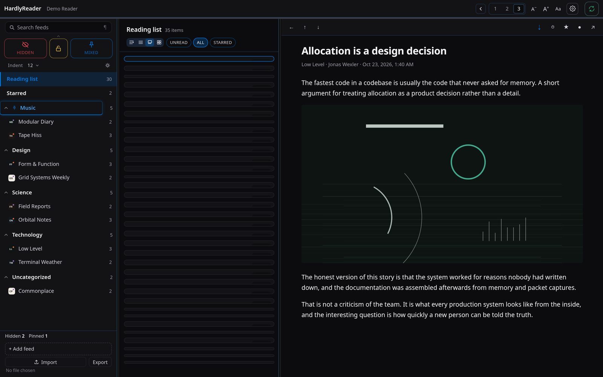
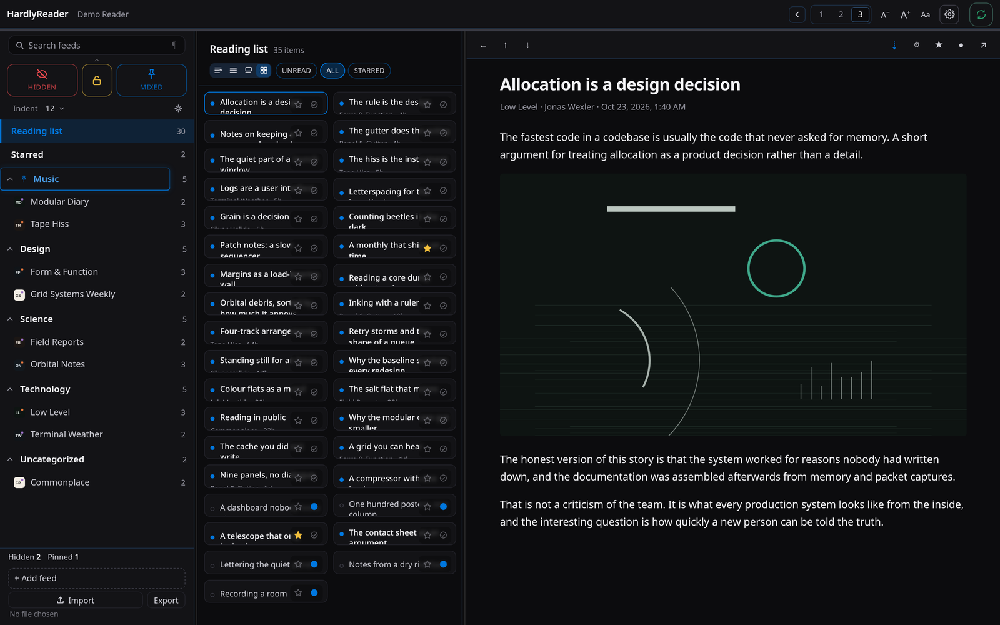
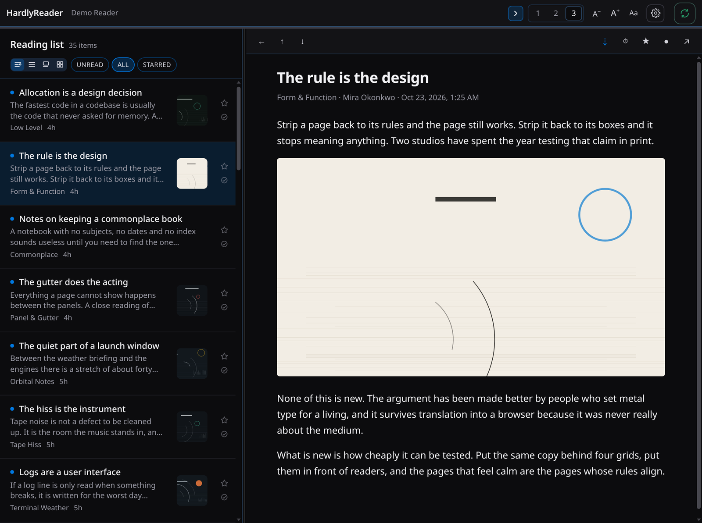
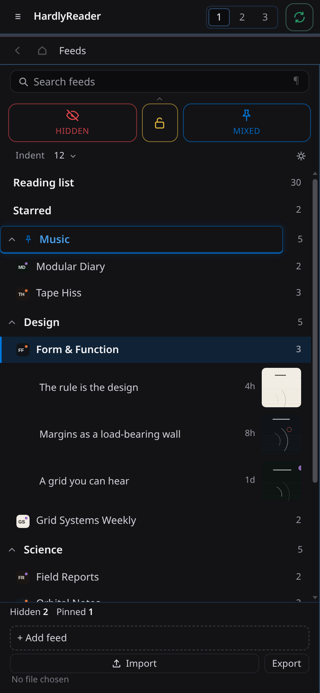
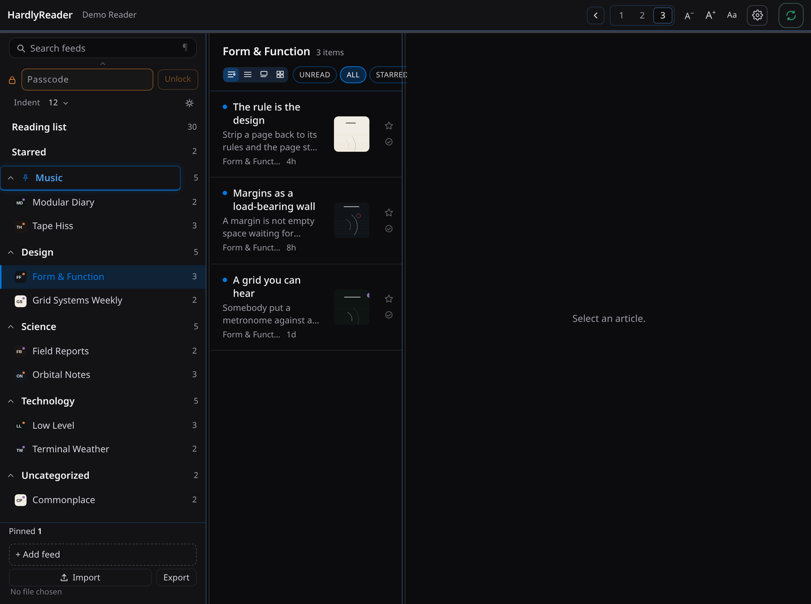
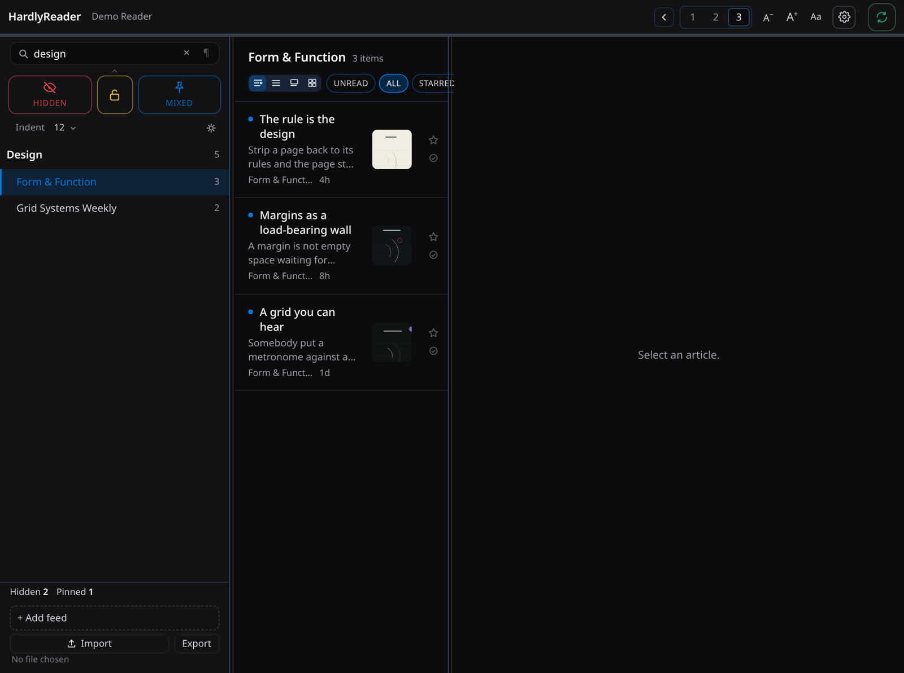
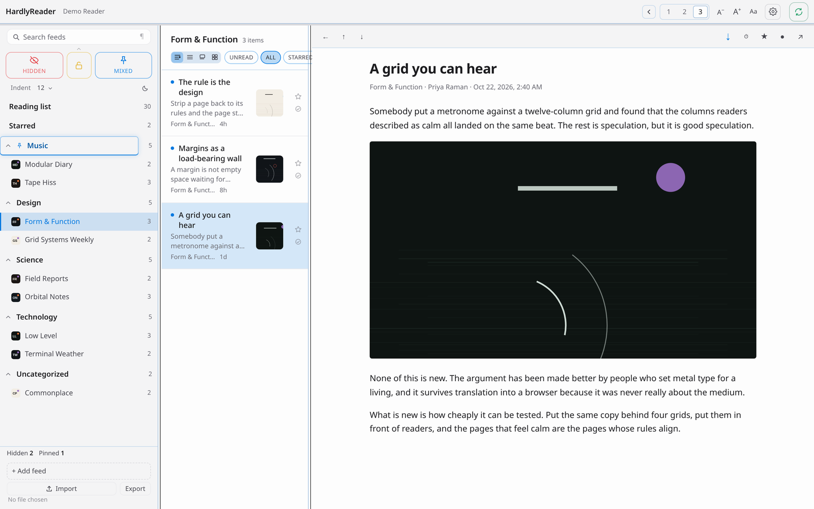
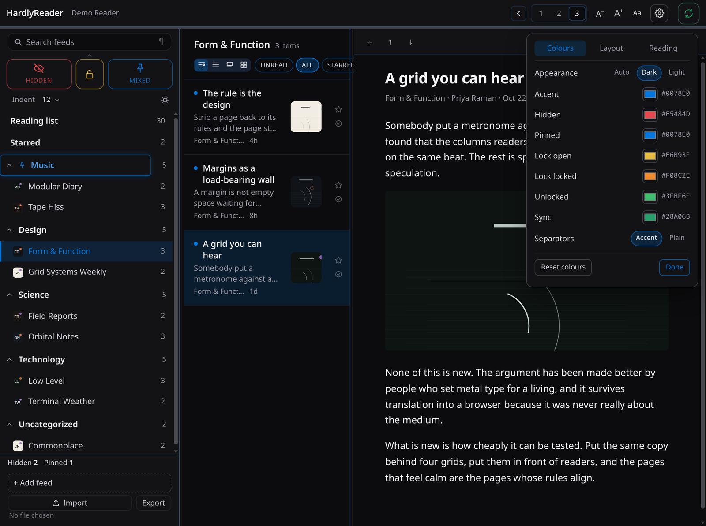
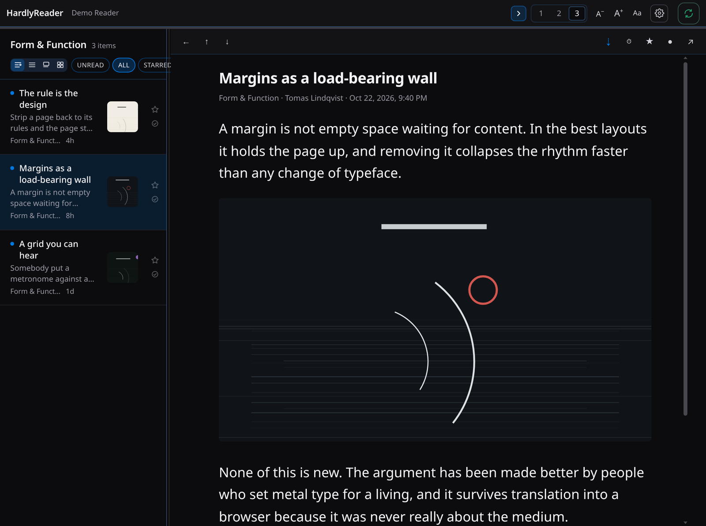
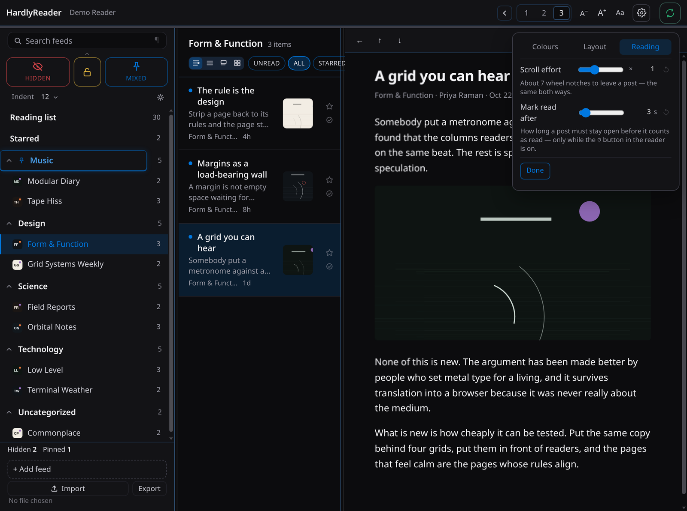

# HardlyReader

A reader for FreshRSS that behaves like a reading app rather than a web page: three panes that fold to one, a keyboard that never needs the mouse, and no reflow while you scroll.

It is also built for reading comics one after another: a Cards view where a page fills the pane at its own size, a wheel or a thumb that moves one post at a time, and an article pane that fits a page whole instead of cropping or blowing it up.

Svelte 5, TypeScript, Tauri 2. Linux desktop today; the same code is the browser build.


## What it does

**Panes that fit the window.** One, two or three columns, chosen in the header or by width. The feeds pane can be folded away without losing the other two, and the widths you drag stay where you put them.

| | |
|---|---|
|  |  |
| **Four ways to list posts** — Regular with thumbnails and a preview, List for density, Cards and Grid for pictures. One row structure behind all four, so every action works in every shape. | |
|  |  |
| **Fold the feeds pane** and the posts keep their width. | **One column** on a narrow window, with a feed's posts unfolded in place. |
|  |  |
| **Locked categories** sit behind a passcode; hidden ones do not leak into counts or screen readers. | **Search** matches feeds *and* categories, and keeps the category around the feeds it found. |
|  |  |
| **Dark, light or automatic**, with the accent and every tone configurable. | **Settings in three tabs** — colours, layout, reading — instead of one long column. |
|  |  |
| **Type and rows scale** independently, to 150% and 140%. | **Reading controls**: measure, leading, alignment, text advance and automatic read marking. |

### Reading

- **Manual or automatic read marking.** Automatic marks a post read after it has been open for the delay you choose; manual leaves it alone until you say so.
- **Keyboard first.** Next/previous post, next/previous feed, mark read, star, open in the browser, go back — every one is a single key, and `?` lists them.
- **Pull down in the post list** to ask the feed for new posts; pull down in an article to leave it, or go to the previous post when advance-on-scroll is on.
- **Scroll that does not jump** — the reader only moves when you ask it to.
- **Article pictures** are fitted whole to the frame at the picture's own resolution, with a multiplier in the article toolbar to make one larger (up to 200%) or smaller (down to 50%) than that automatic fit. It is remembered for every post and across restarts. Row thumbnails have their own scale, and either can be turned off.

### Comics

Cards is the reading view for strips, and it is arranged around the things that actually go wrong when a page of comics meets a feed reader.

- **A page is not cropped.** A card's picture fills the pane's width at its own aspect ratio and its own height — no height cap, no crop, no letterbox. A strip taller than the pane scrolls through it; a strip shorter than the pane is shown whole, with its neighbours peeking above and below.
- **One push, one post.** A wheel notch past a card that fits steps to the next and centres it; a flick on a phone stops at the next card instead of sailing through three. The step is the same pull the article pane uses — the same effort setting and the same delay — and it never opens the post: a tap in the middle does that, and the edges of a card turn the page when it has more than one picture.
- **Multi-picture posts** page by swipe (36px sideways to commit, 12px before it decides it is not a scroll), wrap at both ends, and show their pages as dots under the picture.
- **Unread reads at a glance.** An unread row carries an accent hairline along the bottom that turns up its right edge over a filled corner; a read row steps back as a whole, artwork included.
- **The article fits the page.** In the article pane a picture is fitted to the frame by width, by height and by its own pixel size — whichever is smallest — so a tall page arrives whole and a small file is not stretched into blur. The multiplier beside it goes past that when you want the picture bigger than the fit, or under it to give the text the room.

### Feeds, categories and the extensions

- Feeds, categories and posts all come from FreshRSS over the GReader API: read, unread, star, subscribe and unsubscribe happen server-side as they do on the website.
- Categories can be **hidden** (with three eye states: hidden, revealed, only), **pinned**, and hidden categories can be **locked** behind a passcode. Hiding and pinning are done by two FreshRSS extensions, which stay optional: without them the app runs, with the controls that need them disabled rather than broken.
- Hiding is optimistic — press the eye and the category is gone from the sidebar immediately, with the server catching up.
- Feed pins are local to the device; category pins live on the server, so they follow you.

### The rest

- OPML import and export (folders included).
- Feed icons from the server, with a drawn fallback when there is none.
- A sync button that says what it is doing, and a quiet seam under the header that shows activity without a spinner.
- Session survives a restart; so does where you were — the feed, the open post, the feed unfolded in place, and which categories were folded.

## Requirements

- FreshRSS with **API access enabled** (Settings → Authentication). The API password is what the app asks for, not the account password.
- For the extension-backed features: **Pinned Categories** and/or **Hidden Categories**, plus the small **Hardly Read** adapter that exposes their state over the API.
- To build: Node 20+, pnpm, Rust, and Tauri 2's Linux dependencies (WebKitGTK 4.1).

## Running

```sh
pnpm install
pnpm dev:window     # desktop window (see the note below)
pnpm dev            # browser build on 127.0.0.1:1420
```

`pnpm dev:window` is `pnpm tauri dev` with `WEBKIT_DISABLE_COMPOSITING_MODE=1`
exported. On some Wayland setups WebKitGTK's compositing path paints nothing: the
page loads and runs (requests go out, the DOM is built), but the window shows only
the shell's background colour, which reads as a blank app. If `pnpm tauri dev` gives
you a grey window, use the script or set that variable yourself.

Build a bundle:

```sh
pnpm tauri build    # .deb / .rpm / AppImage in src-tauri/target/release/bundle
```

On first launch, enter the base URL of your FreshRSS (e.g. `https://feeds.example.org`), the account email and the **API password**. Loopback addresses work too (`http://127.0.0.1:8080`).

## Extensions

| Extension | What the app uses it for |
|---|---|
| [Pinned Categories](https://github.com/hardlysleeping/xExtension-FavoriteCategories) | Which categories are pinned, and their order |
| Hidden Categories | Which categories are hidden, the view state, and the lock |
| Hardly Read adapter | One request that returns all of the above, plus the sidebar indent |

Every one of them is optional. The website keeps working the same way with or without the app, and the app keeps working with or without them — it just says so, in the control that needs one.

## Development

```sh
pnpm check    # svelte-check: 0 errors, 0 warnings is the bar
pnpm test     # unit suites, headless, no browser and no server
```

The tests cover the parts that are easy to get quietly wrong: the GReader client, the pane maths, filters and ordering, the extension API's state and error shapes, the reading timer, the lock flows, search grouping, and the memory of where you were.

## Status

0.2.0. The Linux desktop app is what is built and used; the same code runs as a browser build, and the phone layout is exercised but **not** tested on a device yet. There is no offline cache of article bodies or images — a server that is down is a server that is down. Releases are tagged source: no bundles are attached, because the 0.1.1 ones were built against a newer glibc than their targets and are not fit to ship.

Screenshots are of a demo build with invented feeds — no real subscriptions appear in this repository.

## Licence

[PolyForm Noncommercial 1.0.0](LICENSE): free for any **noncommercial** use — read it, run it, change it, share it, build on it. **Commercial use, and distribution through an app store or TestFlight, needs written permission from the author.** That includes selling it, bundling it into something sold, or shipping it to a store under your own name.

This is deliberately not an open-source licence: GPL-3.0 and friends cannot carry a "no commercial use" condition, because GPL §7 forbids adding restrictions on anyone the code is passed to.
