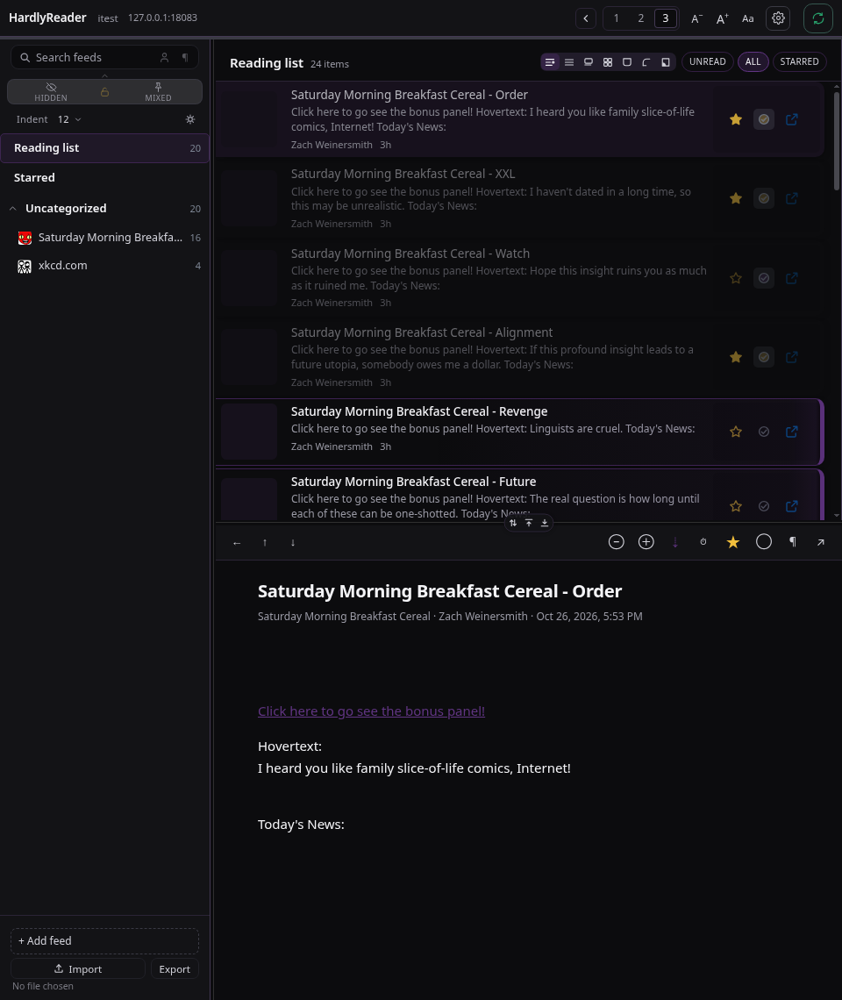
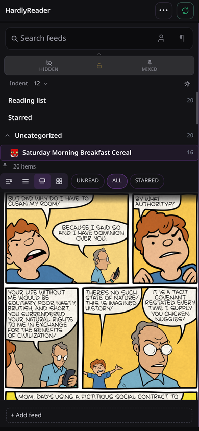
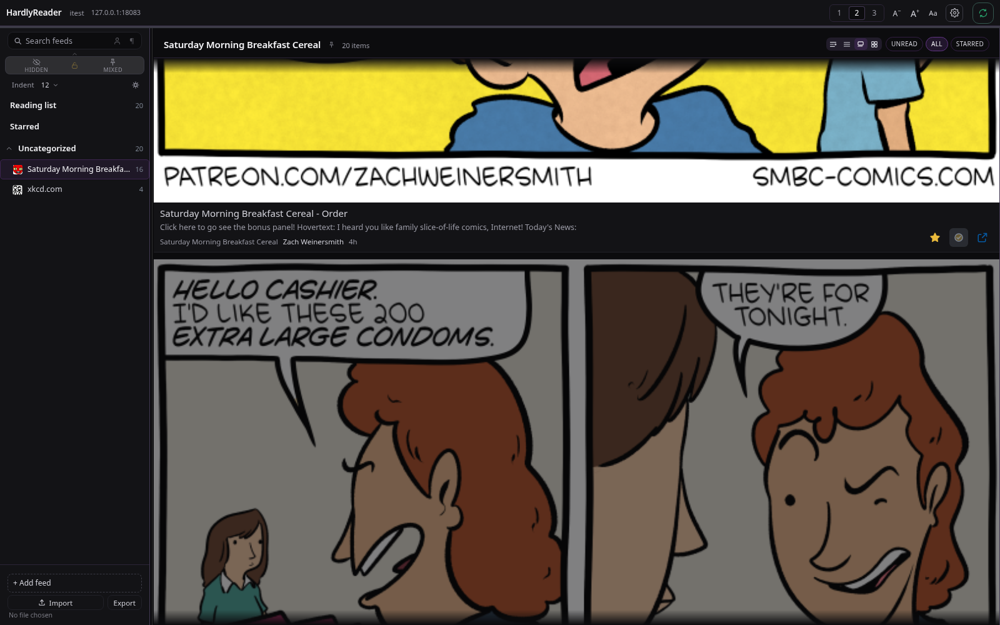

# HardlyReader

A feed reader that runs without a server, and reads your own one when you have it:
three panes that fold to one, a keyboard that never needs the mouse, and no reflow
while you scroll. Cards is built for reading comics one page after another — a page
fills the pane at its own size, one push moves one post, and nothing is cropped.

Two ways to read, one app:

- **No account at all.** A library on the device — feeds you add or import, folders,
  read state, stars, OPML, a real lock, and the text of posts you keep — stored in
  SQLite (IndexedDB in a browser tab). Nothing leaves the machine.
- **Your own server.** Point it at [FreshRSS](https://freshrss.org), Miniflux, Tiny
  Tiny RSS or The Old Reader and everything syncs through it, extension state
  included. Your server does the syncing, for free, as it always has.

Moving a local library between devices is free and manual: **Settings → Device sync →
Archive** has **Export archive** and **Import archive** — feeds, folders, hidden
categories, pins, arrangements, read and starred marks, preferences, positions. The
same canonical files the folder providers write, so the zip can also be unzipped, read,
kept, or dropped into an iCloud Drive folder by hand. Automatic mirroring through iCloud,
Google Drive, Dropbox or OneDrive is the one paid feature — see *Free, and what a
subscription adds* below.

Svelte 5, TypeScript, Tauri 2. One codebase: a Linux desktop window, a browser build
(also shipped as a container), Android, and iOS.


When three columns will not fit they stack — feeds beside the post list, the article
underneath, nothing dropped. One pane is the phone: the feed you picked fills it. Two
panes with Cards reads a comic page at its own size, one card per row.

<p align="center">
  
  
  
</p>

## Install

### Docker (browser, and phone over the LAN)

```sh
docker run -d --name hardlyreader -p 8080:8080 \
  ghcr.io/hardlysleeping/hardlyreader:latest
```

Every release publishes three tags to GHCR — `latest`, the minor line (`0.6`) and the exact version
(`0.6.22`). Pin the version if you would rather not move with the newest build:

```sh
docker run -d --name hardlyreader -p 8080:8080 \
  ghcr.io/hardlysleeping/hardlyreader:0.6.22
```

The image is the browser build on nginx: ~100 MB, nothing to configure, no state on disk. Updating
is `docker pull` and recreate.

Open `http://localhost:8080` and enter your FreshRSS address on the connect
screen — the same one field the desktop app asks for. There is nothing to
configure in the container.

From a clone, `docker compose up -d --build` does the same thing.

One catch that is the browser's, not the app's: a page served over **https** can
only call a server over https. If FreshRSS already has a certificate, put this
page behind one too (any reverse proxy will do); over plain http on a LAN it just
works.

### Linux desktop

Download `HardlyReader_<version>_amd64.AppImage` from
[Releases](https://github.com/hardlysleeping/HardlyReader/releases), then:

```sh
chmod +x HardlyReader_*_amd64.AppImage
./HardlyReader_*_amd64.AppImage
```

A Flatpak bundle is on the same release (`ing.hardlysleep.hardlyreader-<version>.flatpak`,
`flatpak install --user` it). The AppImage needs glibc 2.39 or newer and WebKitGTK 4.1
(`webkit2gtk4.1` on Fedora, Arch and openSUSE; `libwebkit2gtk-4.1-0` on Debian/Ubuntu).
On some Wayland setups WebKitGTK paints nothing and the window stays one flat grey —
start it with `WEBKIT_DISABLE_COMPOSITING_MODE=1` to take the non-compositing path.

### Android and iOS

Both from [Releases](https://github.com/hardlysleeping/HardlyReader/releases).

**Android:** `app-universal-release.apk` — sideload it (Allow from this source). Every
release is signed with the same key, so it installs in place; check the version in
*Settings → About*.

**iOS:** `HardlyReader-<version>-ios-unsigned.ipa` — unsigned on purpose; there is no
paid Apple developer account behind it. Install with [AltStore](https://altstore.io)
or Sideloadly and a free Apple ID (7-day signing). Needs iOS 15 or newer. It is built
by the `iOS unsigned IPA` workflow in this repo on a macOS runner, so every release can
carry one without a second CI account.

## Connect it to FreshRSS

Every install asks for three things once:

- **Server** — the base URL of your FreshRSS, e.g. `https://feeds.example.org`
  (loopback works too: `http://127.0.0.1:8080`). For Docker, this is the
  container's own URL, not the server's.
- **User** — the account name you sign in with.
- **API password** — from FreshRSS *Settings → Authentication → API*, **not**
  the account password. Enable API access there first.

An account whose web login asks for a captcha can be paired instead: the phone
shows a code, and a device that is already signed in approves it under
*Settings → Accounts → Pair a device*. The paired credential is separate from
the password and either side can revoke it.

## What it does

- **Panes that fit the window.** One, two or three columns; the feeds pane folds
  away without disturbing the other two, and dragged widths stay put.
- **Four ways to list posts** — Regular, List, Cards, Grid — one row structure
  behind all four, so every action works in every shape.
- **Cards, for comics.** A page fills the pane's width at its own aspect ratio
  and height: no cap, no crop, no letterbox. One wheel notch or flick moves one
  post and centres it; multi-picture posts page sideways with dots underneath.
  The fit button sizes the window to the whole card — buttons and all — with the
  neighbouring cards showing above and below.
- **The article pane fits a page whole** — by width, height and the file's own
  pixels, whichever is smallest — with a multiplier from 50% to 200%.
- **Keyboard first.** Next/previous post and feed, mark read, star, open in
  browser, back; `?` lists them.
- **Hidden, pinned and locked categories**, via optional extensions (below).
  Hidden categories stay out of counts and screen readers; locked ones sit
  behind a passcode.
- **Search** across feed names, categories and — deeply — post text.
- **Settings in three tabs**: colours (dark, light, automatic, every tone), layout
  (panes, widths, row shape, corners), reading (measure, leading, alignment, type
  scale, automatic read marking).
- OPML import and export, feed icons with a drawn fallback, and a session and
  reading position that survive a restart.

## Free, and what a subscription adds

**Exporting and importing your data is free, always.** *Settings → Device sync → Archive* has two
buttons: **Export archive** writes `HardlyReader-Sync.zip` — through the system save dialog on a
desktop, the share sheet on a phone (AirDrop, Files, mail), a download in a browser — and **Import
archive** opens a file picker and merges that zip in. No account, no trial, no subscription, on
every build. If you would rather move your library by hand than pay for anything, that path never
goes away.

What the subscription adds is **automatic** mirroring for a *local* library: the app keeps the same
data in a folder your own cloud client already syncs — iCloud Drive, Google Drive, Dropbox, OneDrive
— and merges it when you open the app on the other device. No HardlyReader server is involved: that
folder is your storage, and the app only reads and writes the files in it. Today all four are names
for *a folder you pick*, because the app talks to the filesystem, not to CloudKit or the Drive API;
picking `~/iCloud Drive/HardlyReader` or `~/Google Drive/HardlyReader` is the whole setup.

### What sync actually moves — and what it never does

Sync carries **your reading state and arrangement**, never articles:

- feeds and folders, including feeds that moved address
- read and starred marks, with timestamps
- hidden categories, pins, pinned feeds, the eye's view, feed order, category order, sidebar indent
- reading preferences, and where you were reading
- deletions, so a device that was offline cannot resurrect what you removed

Article text, extracted pages, images and fetch times stay on the device. A sync document that
carried articles would grow without bound and upload every few minutes.

**Feeds are fetched by whoever is reading.** In a server profile that is your FreshRSS — it polls
the feeds, stores the articles, and every device reads from it. In a local library the app fetches
the feeds itself (`src/api/local/refresh.ts`) on launch, on resume and when the OS grants a
background moment — so a local library is not a library without feeds. What it does not have is a
*shared* fetcher: two local devices each poll the feeds, and neither can read an article the other
fetched unless the device fetches it too.

### Do you need to pay?

**HardlySyncing is one thing: your local library copied into a folder in your own cloud — iCloud
Drive, Google Drive, Dropbox, OneDrive, or any folder you already mirror — and merged with the copies
on your other devices.** There is no HardlyReader server in the middle, and no article text in the
folder.

| Where your library lives | How the devices stay in step | Cost |
|---|---|---|
| On a feed server — FreshRSS, Inoreader, The Old Reader, Tiny Tiny RSS | The server is the meeting point: it polls the feeds and every device reads from it | **Free** |
| On a service with no GReader API — Feedbin, Feedly | **Import OPML** into a local library, then let **HardlySyncing** carry what the service has no place for: hidden categories, pins, order, indent, read marks, stars | **Free** to import; Sync is a subscription |
| On this device, by hand | **Export archive** on one, **Import archive** on the other | **Free**, always |
| On this device, automatically | **HardlySyncing** — the same files, merged through a folder in your own cloud | $1/month or $10/year |

Read the second row carefully, because it is most of why Sync exists: a service like Feedbin or Feedly
carries feeds and read state and nothing else. Hidden categories, pins, category order, the indent —
none of that has a home there. HardlyReader keeps those on the device, and Sync is what carries them
between your devices. The same is true of an Inoreader or Miniflux server profile: the extras are
ours, so Sync is how they travel when the service has nowhere to put them.

What that leaves out, in three lines:

- **A server carries feeds, read marks, stars and the article text.** Hidden categories, pins, order
  and the indent are ours: on FreshRSS they travel through the two category extensions, and on any
  other service — Inoreader, Miniflux, The Old Reader, or a local library built from Feedbin's OPML —
  they are kept on the device and it is Sync that carries them. `Settings → Extensions` says which
  extras your instance is running.
- **The free way and the paid way carry the same set** — feeds, folders, hidden categories, pins and
  order, indent, read marks, stars, preferences, position. The only difference is that Sync does it
  without you pressing anything, and keeps doing it as you read.
- **Article text never travels through Sync.** If you want the article itself waiting on the train,
  that is what a server is for.

One honest limit, today: the Sync half that carries the extras for a *server* profile is designed —
`docs/authority.md` says so — but the current build only offers the mirror to a library on the device.
A server profile with missing extras shows nothing under Sync yet rather than a price for something it
cannot do.

The rule that keeps this coherent: **one authority per profile.** FreshRSS and its extensions own
a server-backed profile; the local database owns a local one. No state is ever written by two
authorities, and `docs/authority.md` spells out which feature lives where.

## Extensions (optional)

| Extension | What it adds |
|---|---|
| [Pinned Categories](https://github.com/hardlysleeping/xExtension-FavoriteCategories) | Which categories are pinned, and their order |
| [Hidden Categories](https://github.com/hardlysleeping/xExtension-HiddenCategories) | Which categories are hidden, the eye state, and the passcode lock — shared between devices |
| [Hardly Read adapter](https://github.com/hardlysleeping/xExtension-HardlyRead) | One request returning all of the above, plus the sidebar indent |

The app runs without them: pins and hidden categories are kept on the device, so
the sidebar behaves the same way, and the one control that genuinely needs an
extension says so instead of breaking. The extensions themselves are separate
repos and stay optional on the server.

**Settings → Extensions** tells you which of these your FreshRSS is actually running: a row per
piece saying *working*, *not installed*, *waiting on the adapter*, or *could not tell*, with the
link to grab the one that is absent. "Not installed" also covers an extension that is installed but
switched off in FreshRSS, and an adapter older than the app — the server reports those three the
same way, so the screen names them together instead of guessing which one it is. It configures
nothing; it is there so a feature that quietly isn't working has a place to say why.

## Build from source

```sh
pnpm install
pnpm dev            # browser build on 127.0.0.1:1420
pnpm dev:window     # desktop window (tauri dev, compositing disabled — see Notes)
pnpm build          # static browser build in dist/
pnpm tauri build    # desktop bundle
pnpm check          # svelte-check
pnpm test           # unit suites, headless: no browser, no server
```

Building needs Node 22+, pnpm, Rust and Tauri 2's Linux dependencies
(WebKitGTK 4.1). A container needs none of that — see `Dockerfile`.

`pnpm dev` also proxies `/freshrss` to `HARDLYREAD_SERVER` (default
`http://127.0.0.1:18080`) as a convenience when testing against a local
instance; it is not required, and in the desktop app requests go through Tauri's
http plugin regardless.

## Releasing

A release is four bundles on four platforms, in one GitHub release:

- Linux, portable — `HardlyReader_<version>_amd64.AppImage`
- Linux, Flatpak — `ing.hardlysleep.hardlyreader-<version>.flatpak`
- Android — `app-universal-release.apk`
- iOS — `HardlyReader-<version>-ios-unsigned.ipa`

Fewer than four is not a release, even when every step that ran passed. The four
come from different tools, so a step can be skipped without anything failing; a
release that carried only the AppImage has shipped here before. `scripts/release.sh`
is what stops that:

```sh
scripts/release.sh 0.6.8 --ipa path/to/HardlyReader-unsigned.ipa --dry-run
scripts/release.sh 0.6.8 --ipa path/to/HardlyReader-unsigned.ipa
```

It collects the bundles, checks each one exists, is close to the size it should
be and is the kind of file it claims to be, then creates the release as a draft,
uploads all four, reads the draft back, and only then publishes and reads the
published release back. A missing or wrong bundle is named and the run stops
before anything is created on GitHub.

`--build` runs the three builders that work on Linux
(`scripts/build-appimage.sh`, `scripts/build-flatpak.sh`,
`scripts/android-build.sh --release`) first; `--appimage`, `--flatpak` and
`--apk` point at a bundle built somewhere else. The IPA has no Linux builder, so
it is passed in: the `iOS unsigned IPA` workflow (`.github/workflows/ios-unsigned.yml`)
builds it on a macOS runner — `gh workflow run ios-unsigned.yml` — and
`codemagic.yaml` carries the same recipe for anyone who prefers that. `--dry-run`
does every check and prints the exact commands it would run, calling nothing.

## Notes

- The Tauri window runs under a Content-Security-Policy; [`docs/csp.md`](docs/csp.md)
  explains each directive and what only a built app can prove.
- [`docs/android.md`](docs/android.md) covers the Android build and signing.
- No offline cache of article bodies or images for a **server-backed** library: a server that is
  down is a server that is down. A library on this device is the exception, and it keeps only the
  text you asked it to keep — [`docs/article-bodies.md`](docs/article-bodies.md).
- Screenshots use invented feeds; no real subscriptions appear in this repo.

## Licence

[PolyForm Noncommercial 1.0.0](LICENSE): free for any **noncommercial** use —
read it, run it, change it, share it, build on it. **Commercial use, and
distribution through an app store or TestFlight, needs written permission from
the author.** That includes selling it, bundling it into something sold, or
shipping it to a store under your own name.

This is deliberately not an open-source licence: GPL-3.0 and friends cannot carry
a "no commercial use" condition, because GPL §7 forbids adding restrictions on
anyone the code is passed to.
