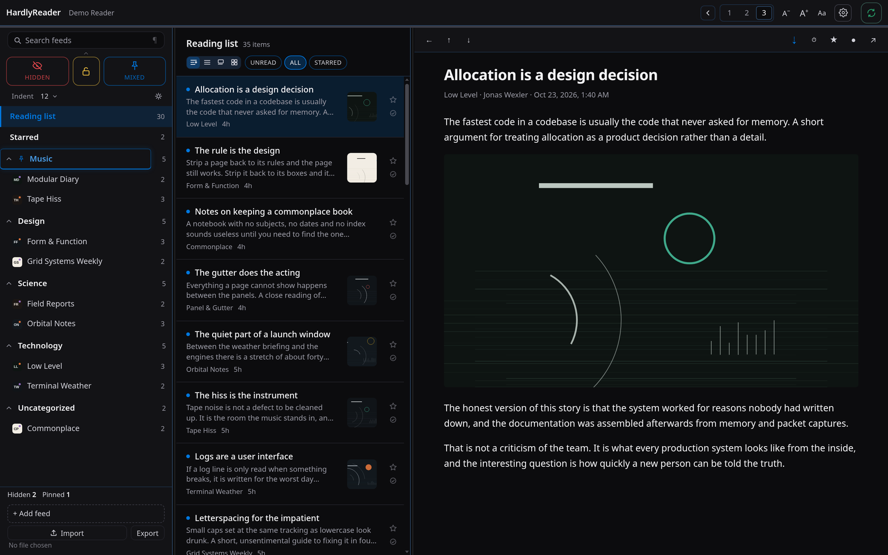

# HardlyReader

A reading app for [FreshRSS](https://freshrss.org): three panes that fold to one,
a keyboard that never needs the mouse, and no reflow while you scroll. Cards is
built for reading comics one page after another — a page fills the pane at its
own size, one push moves one post, and nothing is cropped.

Svelte 5, TypeScript, Tauri 2. One codebase: a Linux desktop window, a browser
build, and Android and iOS.



## Install

### Docker (browser, and phone over the LAN)

```sh
docker run -d --name hardlyreader -p 8080:8080 \
  ghcr.io/hardlysleeping/hardlyreader:latest
```

Open `http://localhost:8080` and enter your FreshRSS address on the connect
screen — the same one field the desktop app asks for. There is nothing to
configure in the container.

From a clone, `docker compose up -d --build` does the same thing.

One catch that is the browser's, not the app's: a page served over **https** can
only call a server over https. If FreshRSS already has a certificate, put this
page behind one too (any reverse proxy will do); over plain http on a LAN it just
works.

### Linux desktop

Download `hardlyreader-<version>-linux-x86_64` from
[Releases](https://github.com/hardlysleeping/HardlyReader/releases), then:

```sh
chmod +x hardlyreader-*-linux-x86_64
./hardlyreader-*-linux-x86_64
```

Needs glibc 2.39 or newer and WebKitGTK 4.1 (`webkit2gtk4.1` on Fedora, Arch and
openSUSE; `libwebkit2gtk-4.1-0` on Debian/Ubuntu). On some Wayland setups
WebKitGTK paints nothing and the window stays one flat grey — start it with
`WEBKIT_DISABLE_COMPOSITING_MODE=1` to take the non-compositing path.

### Android and iOS

Both from [Releases](https://github.com/hardlysleeping/HardlyReader/releases).

**Android:** `hardlyreader-<version>-android-universal.apk` — sideload it (Allow
from this source). Every release is signed with the same key, so it installs in
place.

**iOS:** `hardlyreader-<version>-ios-unsigned.ipa` — unsigned; there is no paid
Apple developer account behind it. Install with [AltStore](https://altstore.io)
or Sideloadly and a free Apple ID (7-day signing). Needs iOS 15 or newer.

## Connect it to FreshRSS

Every install asks for three things once:

- **Server** — the base URL of your FreshRSS, e.g. `https://feeds.example.org`
  (loopback works too: `http://127.0.0.1:8080`). For Docker, this is the
  container's own URL, not the server's.
- **User** — the account name you sign in with.
- **API password** — from FreshRSS *Settings → Authentication → API*, **not**
  the account password. Enable API access there first.

An account whose web login asks for a captcha can be paired instead: the phone
shows a code, and a device that is already signed in approves it under
*Settings → Accounts → Pair a device*. The paired credential is separate from
the password and either side can revoke it.

## What it does

- **Panes that fit the window.** One, two or three columns; the feeds pane folds
  away without disturbing the other two, and dragged widths stay put.
- **Four ways to list posts** — Regular, List, Cards, Grid — one row structure
  behind all four, so every action works in every shape.
- **Cards, for comics.** A page fills the pane's width at its own aspect ratio
  and height: no cap, no crop, no letterbox. One wheel notch or flick moves one
  post and centres it; multi-picture posts page sideways with dots underneath.
  The fit button sizes the window to the whole card — buttons and all — with the
  neighbouring cards showing above and below.
- **The article pane fits a page whole** — by width, height and the file's own
  pixels, whichever is smallest — with a multiplier from 50% to 200%.
- **Keyboard first.** Next/previous post and feed, mark read, star, open in
  browser, back; `?` lists them.
- **Hidden, pinned and locked categories**, via optional extensions (below).
  Hidden categories stay out of counts and screen readers; locked ones sit
  behind a passcode.
- **Search** across feed names, categories and — deeply — post text.
- **Settings in three tabs**: colours (dark, light, automatic, every tone), layout
  (panes, widths, row shape, corners), reading (measure, leading, alignment, type
  scale, automatic read marking).
- OPML import and export, feed icons with a drawn fallback, and a session and
  reading position that survive a restart.

## Extensions (optional)

| Extension | What it adds |
|---|---|
| [Pinned Categories](https://github.com/hardlysleeping/xExtension-FavoriteCategories) | Which categories are pinned, and their order |
| [Hidden Categories](https://github.com/hardlysleeping/xExtension-HiddenCategories) | Which categories are hidden, the eye state, and the passcode lock — shared between devices |
| [Hardly Read adapter](https://github.com/hardlysleeping/xExtension-HardlyRead) | One request returning all of the above, plus the sidebar indent |

The app runs without them: pins and hidden categories are kept on the device, so
the sidebar behaves the same way, and the one control that genuinely needs an
extension says so instead of breaking. The extensions themselves are separate
repos and stay optional on the server.

## Build from source

```sh
pnpm install
pnpm dev            # browser build on 127.0.0.1:1420
pnpm dev:window     # desktop window (tauri dev, compositing disabled — see Notes)
pnpm build          # static browser build in dist/
pnpm tauri build    # desktop bundle
pnpm check          # svelte-check
pnpm test           # unit suites, headless: no browser, no server
```

Building needs Node 22+, pnpm, Rust and Tauri 2's Linux dependencies
(WebKitGTK 4.1). A container needs none of that — see `Dockerfile`.

`pnpm dev` also proxies `/freshrss` to `HARDLYREAD_SERVER` (default
`http://127.0.0.1:18080`) as a convenience when testing against a local
instance; it is not required, and in the desktop app requests go through Tauri's
http plugin regardless.

## Notes

- The Tauri window runs under a Content-Security-Policy; [`docs/csp.md`](docs/csp.md)
  explains each directive and what only a built app can prove.
- [`docs/android.md`](docs/android.md) covers the Android build and signing.
- No offline cache of article bodies or images: a server that is down is a
  server that is down.
- Screenshots use invented feeds; no real subscriptions appear in this repo.

## Licence

[PolyForm Noncommercial 1.0.0](LICENSE): free for any **noncommercial** use —
read it, run it, change it, share it, build on it. **Commercial use, and
distribution through an app store or TestFlight, needs written permission from
the author.** That includes selling it, bundling it into something sold, or
shipping it to a store under your own name.

This is deliberately not an open-source licence: GPL-3.0 and friends cannot carry
a "no commercial use" condition, because GPL §7 forbids adding restrictions on
anyone the code is passed to.
